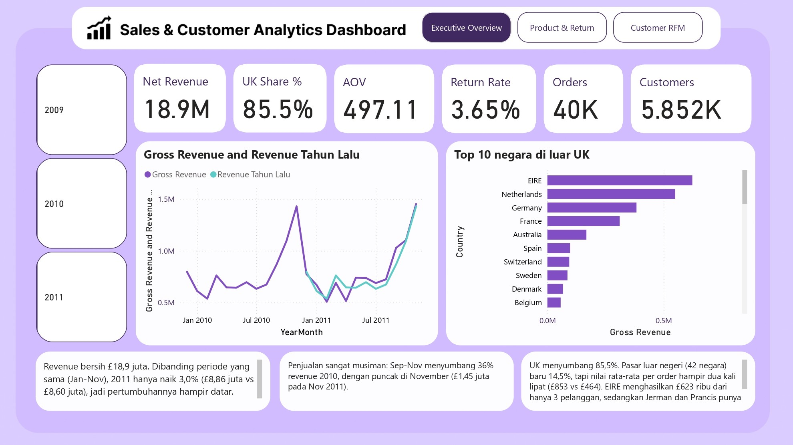
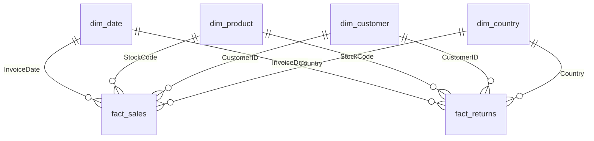

# Retail Sales & Customer Analytics Dashboard (Power BI)

Dashboard 3 halaman yang menganalisis 1 juta+ transaksi toko online di UK untuk menjawab: **produk dan pelanggan mana yang menopang revenue, dan siapa yang mulai pergi?**



> Tools: Python (pandas) untuk data cleaning, Power BI + DAX untuk modeling dan visualisasi.
> Dataset: Online Retail II (UCI / Kaggle). Mata uang: pound sterling (£).

## Business Problem

Sebuah toko online grosir hadiah dan dekorasi di UK ingin memahami performa penjualannya. Dashboard ini dirancang untuk tiga pengguna:

| Halaman | Pengguna | Pertanyaan yang dijawab |
|---|---|---|
| 1. Executive Overview | Manajemen | Bagaimana performa revenue secara keseluruhan? Pasar mana yang utama? |
| 2. Product & Return | Tim produk dan inventory | Produk mana yang menopang revenue, dan mana yang bermasalah di retur? |
| 3. Customer RFM | Tim sales dan marketing | Siapa pelanggan paling bernilai, dan siapa yang perlu didekati lagi? |

## Dataset

- **Sumber:** Online Retail II
- **Periode:** 1 Des 2009 sampai 9 Des 2011
- **Ukuran:** 1.067.371 baris, 5.942 pelanggan, 43 negara
- **Kolom:** InvoiceNo, StockCode, Description, Quantity, InvoiceDate, UnitPrice, CustomerID, Country

## Proses

### 1. Data cleaning (Python)
Script: [`scripts/clean_online_retail.py`](scripts/clean_online_retail.py). Setiap baris data mentah masuk tepat ke satu tabel output, dan ada rekonsiliasi baris serta nilai di akhir.

| Masalah di data mentah | Jumlah baris | Penanganan |
|---|---|---|
| Baris duplikat (identik penuh) | 34.335 | Dibuang ke `rejected_rows` |
| Harga ≤ 0 (stok hilang, rusak, gratis) | 5.962 | Dibuang ke `rejected_rows` |
| Bukan produk (ongkir, biaya admin, adjustment, voucher, data uji) | 5.820 | Dipisah ke `non_product_items` |
| Invoice batal (diawali "C") | 17.914 | Dipisah ke `fact_returns`, tidak dicampur ke revenue |
| Customer ID kosong | 243.007 (±23%) | Dipertahankan dan ditandai `HasCustomer = False`. Dikeluarkan dari analisis pelanggan |
| Desember 2011 tidak lengkap (data berhenti 9 Des) | n/a | Ditandai `IsCompleteMonth = False` |

Hasil akhir: 1.003.340 baris di `fact_sales`, 17.914 di `fact_returns`, 5.820 di `non_product_items`, dan 40.297 di `rejected_rows`. Totalnya sama dengan 1.067.371 baris mentah.

### 2. Data model (Power BI, star schema)



### 3. Analisis dan DAX
- **Measure:** Gross Revenue, Return Value, Net Revenue, Orders, AOV, Customers, Return Rate, Revenue MoM/YoY, UK Share %, Top 20% Product Share (Pareto), Repeat Customer %.
- **RFM:** Recency, Frequency, dan Monetary diberi skor 1-5 lalu dikelompokkan menjadi 6 segmen: Champions, Loyal, New / Promising, Need Attention, At Risk, Hibernating / Lost.

## Key Insights dan Rekomendasi

**Halaman 1: Executive Overview**
- Revenue bersih £18,9 juta. Dibanding periode yang sama (Jan-Nov), 2011 hanya naik **3,0%** (£8,86 juta vs £8,60 juta).
- Penjualan sangat musiman: Sep-Nov menyumbang **36% revenue 2010**, dengan puncak di November.
- **UK menyumbang 85,5% revenue.** Pasar luar negeri (42 negara) baru 14,5%, tetapi nilai rata-rata per order hampir dua kali lipat (£853 vs £464). EIRE menghasilkan £623 ribu dari hanya 3 pelanggan.
- *Rekomendasi:* siapkan stok Q4 mulai Agustus, jaga akun besar di EIRE dan Belanda secara personal, dan kembangkan Jerman dan Prancis lewat promosi karena basis pelanggannya luas.

**Halaman 2: Product & Return**
- **20% produk teratas menghasilkan 78% revenue** (pola Pareto). Penopang utama: REGENCY CAKESTAND 3 TIER dan WHITE HANGING HEART T-LIGHT HOLDER.
- Return Rate tampak 3,65%, tetapi **34,3% nilai retur berasal dari dua order raksasa yang dibatalkan di hari yang sama** (80.995 unit dan 74.215 unit). Tanpa keduanya, return rate wajar sekitar **2,4%**.
- *Rekomendasi:* audit order bernilai sangat besar sebelum diproses, dan selidiki produk dengan retur 80-100%.

**Halaman 3: Customer RFM**
- **24% pelanggan (Champions) menghasilkan 69%** revenue dari pelanggan yang punya ID. 72% pelanggan membeli lebih dari sekali.
- 1% pelanggan teratas menyumbang **31%** revenue bersih.
- Segmen **At Risk: 709 pelanggan senilai £1,52 juta**, target kampanye reaktivasi.
- *Rekomendasi:* program loyalitas untuk Champions, kampanye reaktivasi At Risk sebelum Q4, dan wajibkan pencatatan Customer ID (13,1% revenue tidak punya ID).

## Keterbatasan

- Desember 2011 tidak lengkap, sehingga perbandingan pertumbuhan memakai Jan-Nov.
- 13,1% revenue tidak punya Customer ID, jadi tidak ikut analisis pelanggan.
- Skor RFM memakai revenue **sebelum retur**, sehingga pelanggan dengan order besar yang dibatalkan bisa terlihat lebih bernilai dari sebenarnya.
- Duplikat identik dianggap kesalahan input. Sebagian bisa saja pembelian ganda yang sah.
- Dua order raksasa yang dibatalkan diduga order uji atau salah input, tetapi ini perlu dikonfirmasi ke pemilik data.

## Cara Membuka

1. **Dashboard:** buka [`dashboard/Retail_Analytics.pbip`](dashboard/Retail_Analytics.pbip) dengan Power BI Desktop, atau lihat [`docs/`](docs/).
2. **Menjalankan cleaning ulang:**
   ```bash
   pip install pandas numpy
   python scripts/clean_online_retail.py --input data/online_retail_II.csv --output ./clean_output
   ```
3. Saat mengimpor CSV hasil cleaning ke Power BI, set Locale for import ke **English (United States)** dan pastikan kolom angka bertipe **Decimal Number**.

## Struktur Repo

```
├── README.md
├── dashboard/        file .pbix
├── scripts/          clean_online_retail.py
├── data_quality/     data_quality_log.csv, data_quality_report.md
└── docs/             screenshot halaman 1-3 dan dashboard.pdf
```

Data mentah tidak disertakan karena ukurannya besar. Unduh di UCI Machine Learning Repository atau Kaggle (Online Retail II).
